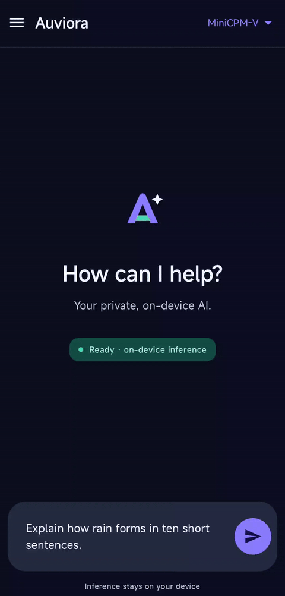
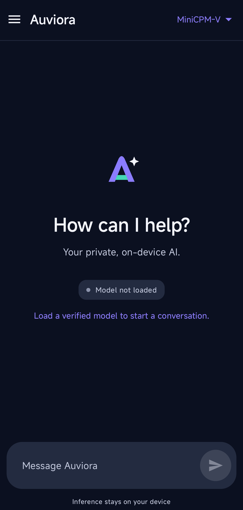
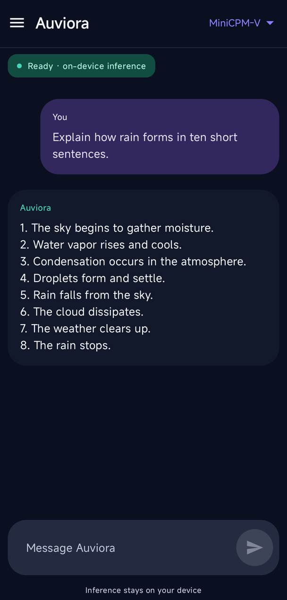
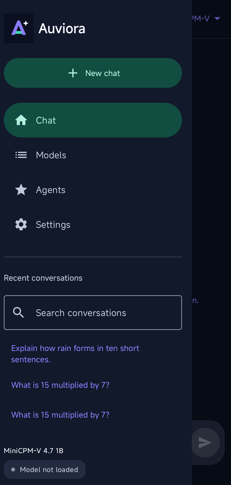
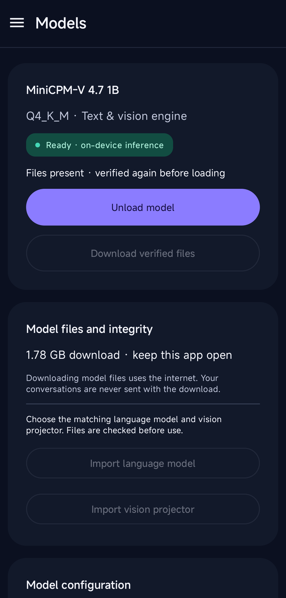
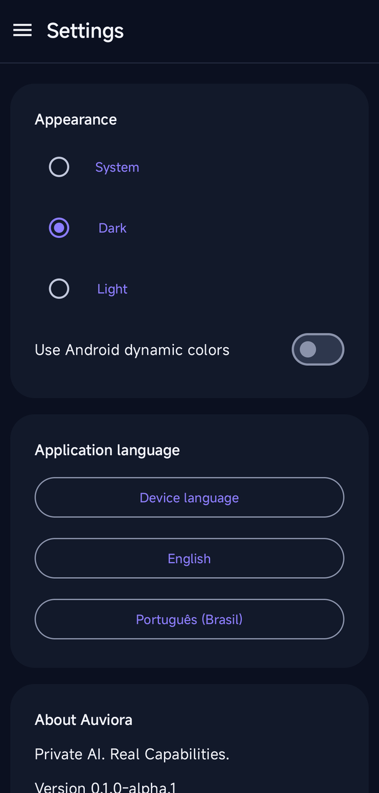
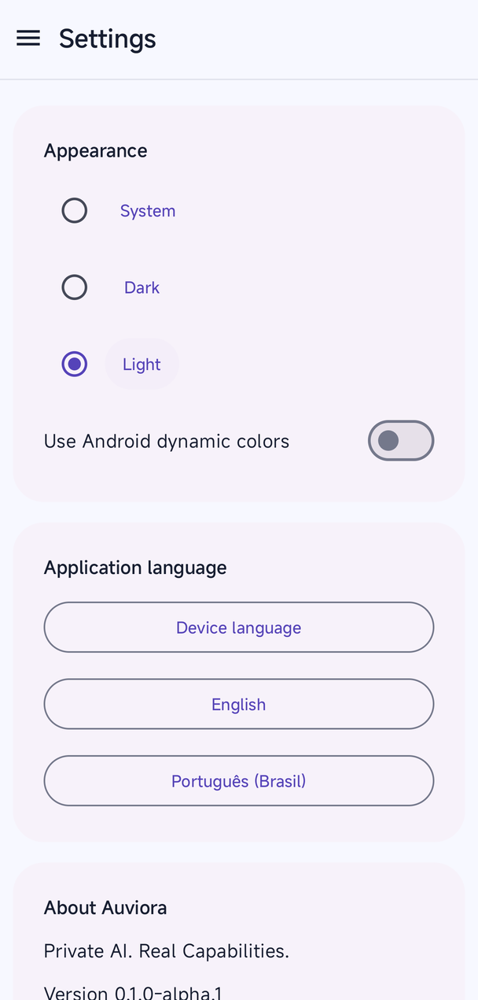

<p align="center">
  
</p>
<h1 align="center">Auviora</h1>
<p align="center"><strong>Private AI. Real Capabilities.</strong></p>
<p align="center">An independent Android home for private, on-device AI.</p>
<p align="center">
  
  
  
  
</p>
<p align="center">
  <a href="docs/i18n/pt-BR/README.md"><strong>Guia em português brasileiro</strong></a> ·
  <a href="#real-offline-inference">Watch the demo</a> ·
  <a href="#build-and-install">Build</a> ·
  <a href="docs/ROADMAP.md">Roadmap</a>
</p>

Auviora is an offline-first AI application built with Kotlin and Jetpack Compose. Its independent Android interface connects to a pinned `llama.cpp-omni` backend through a dedicated inference module. Model files are provisioned explicitly; text generation then runs locally, including streaming and cancellation.

**Development preview: `0.1.0-alpha.1` (code 1).** The application foundation and real offline text inference have been validated on Android hardware. There is no published APK release or bundled model. Auviora is being built toward multimodal assistance; the current chat accepts **text only**. The backend includes a vision projector, but image attachment and vision validation in this application remain future work.

## Download the Alpha

[**GitHub Releases — Auviora Alpha**](https://github.com/eobarretooo/Auviora/releases)

The release process is being established for **v0.1.0-alpha.1**. A signed downloadable APK has not been published yet; do not install or distribute an unsigned local candidate. When available, download the ARM64 APK and SHA256SUMS.txt from the actual release and compare the APK with `Get-FileHash FILE.apk -Algorithm SHA256` before installation.

The build requires an ARM64 device with API 24+; hardware evidence is currently Android 16 only. Model files are downloaded separately (approximately 1.78 GB); downloading uses internet, inference after provisioning is local. A release certificate differs from debug: replacing a debug installation may require uninstalling, which deletes private conversations and downloaded models. **No automatic uninstall is performed.** Read the [release process](docs/RELEASE_PROCESS.md), [Alpha notes](docs/releases/v0.1.0-alpha.1.md) and [changelog](docs/CHANGELOG.md) before installing.

## What works today

- **Local streamed chat:** real generated tokens, visible engine states and a Stop control.
- **Verified model provisioning:** explicit download or Android document-picker import, exact size/SHA-256 checks, load and unload controls.
- **A focused Android interface:** left navigation drawer, adaptive sidebar layout, Material 3 components and dark, light, system or optional Android dynamic colors.
- **Basic local history:** actual conversations saved atomically, recent items and title search. Saved conversations currently open as read-only views.
- **English and Brazilian Portuguese:** in-app language selection with localized interface resources.

Executable agents, background app automation, advanced persistent memory, image attachments and complete conversation-context restoration are **planned, not available**. The Agents destination explains its disabled state. See the [current scope and limitations](docs/AI_HANDOFF.md).

## Real offline inference

<p align="center">
  
</p>

Recorded from the actual development APK on Android 16, with airplane mode enabled, Wi-Fi/mobile data disabled and no active default network verified before and after generation. The clip starts with a prepared draft, shows the response appearing in the chat, with the selected model and Ready state visible. Playback uses the original timing; the model's words are unchanged. This is a demonstration, not a speed or answer-quality benchmark.

[Capture provenance, exact transformations and reproduction](docs/media/README.md) · [Phase 2.0 runtime validation](docs/testing/PHASE_02_VALIDATION.md)

## Inside the application

<p align="center">
  <a href="docs/media/screenshots/welcome-dark.png"></a>
  <a href="docs/media/screenshots/offline-chat-dark.png"></a>
  <a href="docs/media/screenshots/navigation-dark.png"></a>
</p>
<p align="center">
  <a href="docs/media/screenshots/models-ready-dark.png"></a>
  <a href="docs/media/screenshots/settings-dark.png"></a>
  <a href="docs/media/screenshots/settings-light.png"></a>
</p>

Welcome, offline chat, navigation, models and two real Settings themes. Open an image for readable full-size detail. Screenshots are cropped to exclude system bars and optimized for documentation. Original Phase 2.0 testing captures remain intact; the [media guide](docs/media/README.md) also includes the light welcome screen.

## Compatibility and stack

| Layer | Current configuration |
|---|---|
| Android | Minimum API 24; target API 36; compile SDK 36.1 |
| Packaged ABI | `arm64-v8a` only |
| UI | Kotlin 2.2.10, Jetpack Compose, Material 3; BOM 2025.08.00 |
| Build | Gradle wrapper 9.3.1, Android Gradle Plugin 9.1.1, JDK 21 |
| Native | NDK 27.0.12077973, CMake 4.1.2, JNI, pinned `llama.cpp-omni` |
| Storage | App-private model files and atomic JSON conversation history |

**Hardware evidence is currently limited to one ARM64 Android 16/API 36 device.** The minimum SDK is a build requirement, not a tested-device guarantee. Adequate free storage and memory are needed for the model pair and native context; no universal minimum RAM or tablet compatibility claim has been established. Dynamic colors require API 31+.

## Build and install

Check out this repository with Git. On Windows, install JDK 21 and the Android SDK/NDK/CMake versions above; configure `JAVA_HOME` and `ANDROID_HOME` for your machine. Android Studio can manage the SDK components. Do not commit local SDK paths.

```powershell
git submodule update --init --recursive --depth 1
./gradlew.bat :app:assembleDebug
```

CMake automatically applies the parent-owned portability patch to the public pinned submodule. A patch-only modified vendor working tree is expected. No sibling reference checkout is required. Read [native provenance](docs/legal/PROVENANCE.md) before changing the pin or patch.

With an ARM64 Android connected, authorize USB debugging and local USB installation, then replace `DEVICE_SERIAL` with the value from `adb devices`:

```powershell
adb -s DEVICE_SERIAL install -r app/build/outputs/apk/debug/app-debug.apk
```

Launch **Auviora** on the device. This is a local debug build (`app.auviora.android`), not a production release. Full build, lint, integrity and opt-in hardware commands are in [Testing](docs/TESTING.md).

## Set up the supported model

The current catalog contains one verified profile: **MiniCPM-V 4.7 1B**, using the exact conversion pair below.

| Artifact | Role | Size |
|---|---|---:|
| `MiniCPM-V-4_7-1B-Q4_K_M.gguf` | Q4_K_M language model | 672,003,584 bytes |
| `mmproj-model-f16.gguf` | Matching vision projector | 1,108,746,816 bytes |

1. Open **Models** and choose **Download verified files**, or import each exact artifact through the document picker. Downloading requires internet access and approximately 1.78 GB for the pair; allow additional free space for temporary files. Keep Auviora open during provisioning.
2. Choose **Load model** and wait for **Ready**. File presence alone does not mean the model is loaded. Both artifacts are fully checked again before use.
3. Return to **Chat**, send a message and use **Stop** when needed. After provisioning, text inference works offline.
4. Use **Unload model** to release model/session resources when finished.

The source repository, immutable conversion revision, hashes and separate model-license limitations are in the [artifact manifest](docs/testing/model-artifacts.json) and [provenance notes](docs/legal/PROVENANCE.md). Arbitrary GGUF files are not interchangeable with this profile. The compact model can mix languages, invent its identity and make factual mistakes; its output needs review. Import exists in source, but the interactive provider/picker matrix remains unverified.

## Architecture

```text
:app        Compose screens, ViewModel, local conversations and provisioning
   │        depends on :core and :inference
   ▼
:core       Engine contracts, model profile, state/errors and integrity checks
   ▲
:inference  Serial native owner → JNI → pinned llama.cpp-omni
```

The UI consumes core contracts; only the inference module owns JNI. Native work is serialized, cancellation settles before unload, and errors remain visible. Future model adapters can build on the contracts; a general multi-model plugin system is not implemented.

[Architecture](docs/ARCHITECTURE.md) · [Project structure](docs/PROJECT_STRUCTURE.md) · [Design contract](docs/design/DESIGN.md) · [Roadmap](docs/ROADMAP.md)

## Documentation and contributing

- [Brazilian Portuguese guide](docs/i18n/pt-BR/README.md)
- [Testing and evidence](docs/TESTING.md) and [media workflow](docs/media/README.md)
- [Development handoff](docs/AI_HANDOFF.md) and [development log](docs/DEVELOPMENT_LOG.md)
- [Phase 2.1 report](docs/PHASES/PHASE_02_1.md) and [Android quality backlog](docs/design/ANDROID_QUALITY_BACKLOG.md)
- [Contributing](docs/CONTRIBUTING.md) and [changelog](docs/CHANGELOG.md)

Contributions should preserve local inference, explicit user control and third-party attribution. Read the handoff and contribution guide first, keep changes focused, and report host checks separately from real-device tests. Future product phases require explicit scope; this presentation phase does not start Phase 3.

## License and attribution

Auviora source is [MIT licensed](LICENSE), with original tc-mb/OpenBMB reference credits and MIT notice preserved in [REFERENCE_LICENSE.txt](docs/legal/REFERENCE_LICENSE.txt). The pinned native engine and bundled dependencies retain their own notices; see [legal provenance](docs/legal/PROVENANCE.md). Model weights have separate terms: conversion redistribution and complete binary notice assembly still require review before publication. No model weights are committed or distributed by this repository.
